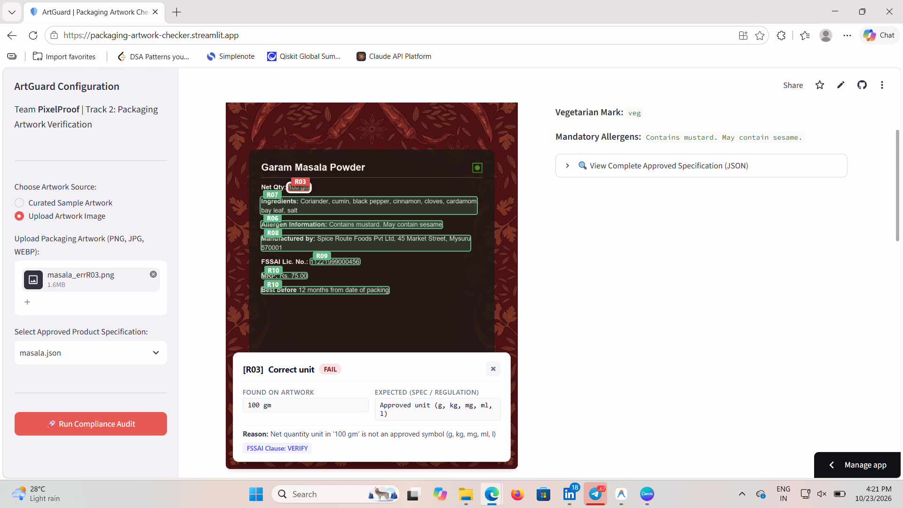
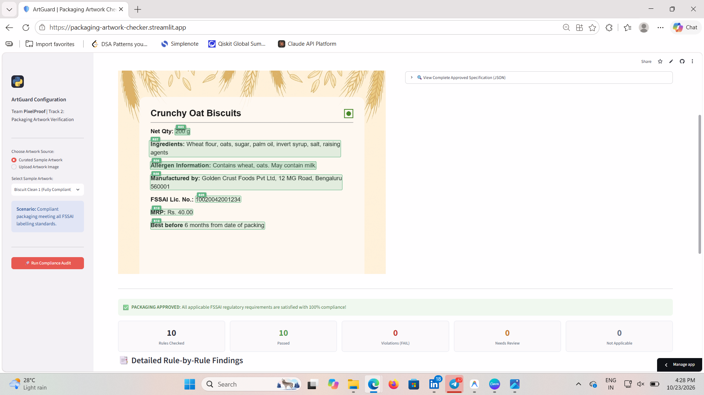
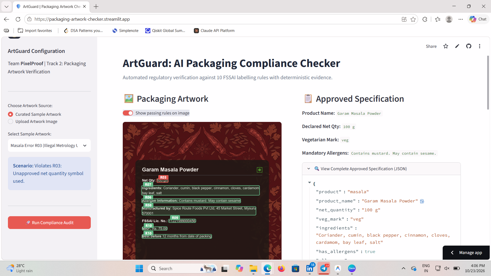
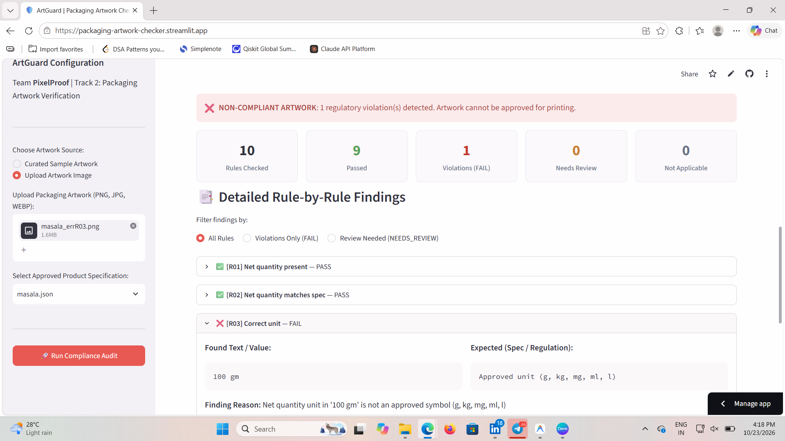
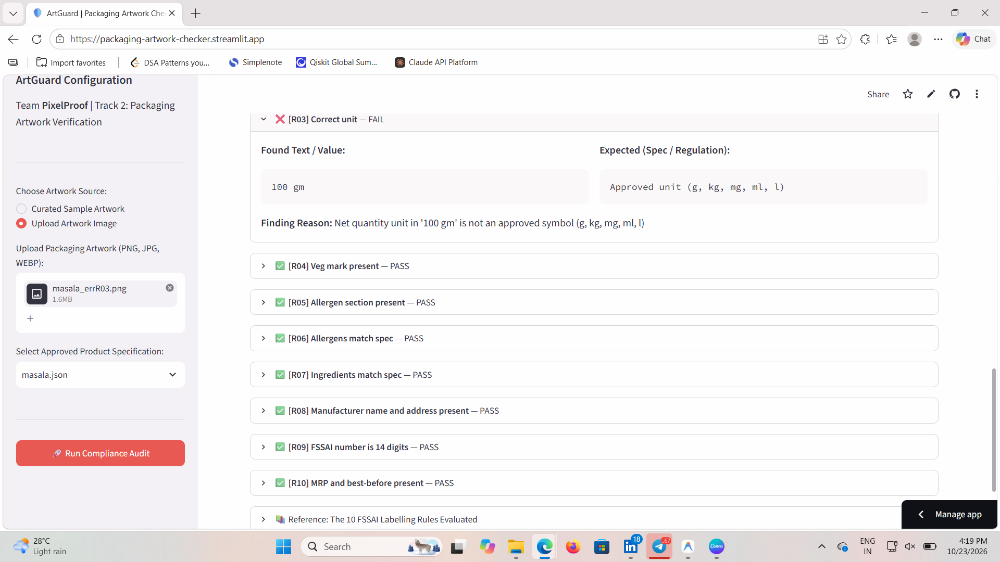
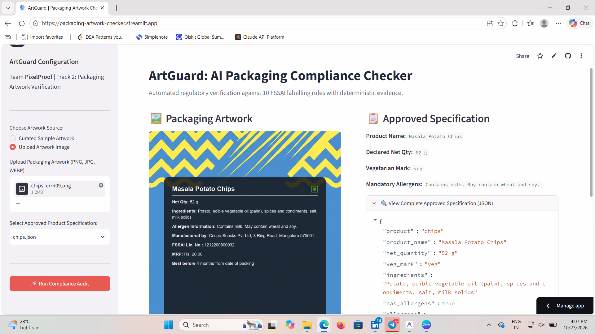
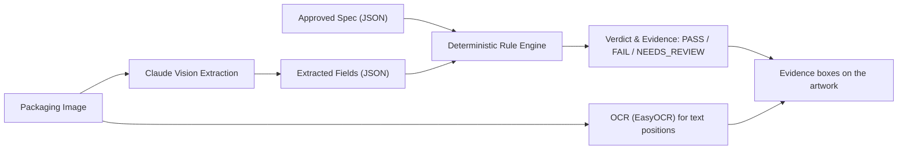

# ArtGuard: AI-Powered Packaging Artwork Compliance Checker for FSSAI Regulations

**Team Pixel Proof** | Esko Hackathon, Track 2

Automated regulatory compliance verification for packaged food artwork against FSSAI labelling regulations.

**Live demo:** https://packaging-artwork-checker.streamlit.app
*(If the app is asleep, click "Yes, get this app back up" and wait about a minute.)*

---

## Demo

Pick a sample (or upload your own artwork and choose its approved spec), then click **Run Compliance Audit**. Click any box on the artwork to see why it was flagged.


*Click a flagged box: found value vs expected value, the reason and the FSSAI clause.*

| Compliant label | Violation detected |
|---|---|
|  |  |
| *All 10 rules pass, shown in green* | *Illegal unit "gm" in red, passing rules in green* |

| Instant verdict | Rule-by-rule reasoning |
|---|---|
|  |  |
| *10 rules checked, 9 passed, 1 violation* | *Every rule has a found-vs-expected card* |


*Upload your own artwork and select its approved spec.*

---

## 1. Overview

Food packaging artwork must strictly comply with mandatory labelling standards before going to print. Manual artwork auditing is slow, repetitive, and vulnerable to missed violations or costly false rejections.

This system takes a **packaging artwork image** and an **approved product specification**, extracts declared packaging copy via vision AI, and validates it against **10 FSSAI labelling rules** using deterministic Python verification. Every rule verdict is backed by explicit evidence (extracted text, expected value, and reason), and the evidence is drawn directly on the artwork.

---

## 2. How It Works



### Core Design Principles
- **Model only reads**: The vision model (Claude Sonnet) is used strictly as a transcriber to read printed label text. It **never** sees the specification or makes regulatory compliance decisions.
- **Deterministic verification**: All rule evaluations (comparisons, regex, equality, unit checks) run in deterministic Python code.
- **Fail-safe uncertainty**: If field extraction confidence is low (< 0.60) or ingredient ordering is scrambled, the system flags `NEEDS_REVIEW` instead of guessing or raising false alarms.
- **No cascading errors**: Dependent rules (e.g., R02 quantity match and R03 unit check) return `N/A` when the primary field is absent (R01 missing net quantity), eliminating downstream false alarms.
- **Evidence on the artwork**: OCR provides text positions, so each finding is highlighted where it occurs. Missing items (for example an absent allergen section) are shown as a dashed region with a label.

---

## 3. The 10 Labelling Rules

| Rule ID | Name | What It Checks | How It Is Checked |
|:---|:---|:---|:---|
| **R01** | Net Quantity Present | Net quantity declaration exists on packaging | Non-empty field detection |
| **R02** | Net Quantity Matches Spec | Declared numerical quantity matches approved spec | Normalized numerical equality (`N/A` if missing) |
| **R03** | Correct Measurement Unit | Conformance to Legal Metrology standards | Regex match for approved units (`g`, `kg`, `mg`, `ml`, `l`) |
| **R04** | Vegetarian Mark Present | Green square outline with filled green circle | Vision symbol detection |
| **R05** | Allergen Section Present | Allergen declaration present when spec declares allergens | Presence check (`N/A` if spec has no allergens) |
| **R06** | Allergens Match Spec | All specified allergen ingredients declared | Exact word-set containment against spec allergens |
| **R07** | Ingredients Match Spec | Ingredient list match and declared order | Comma-split, 1-to-1 item matching (`difflib` ratio $\ge 0.9$) |
| **R08** | Manufacturer Address | Manufacturer name and physical postal address present | String similarity against approved spec ($\ge 0.70$) |
| **R09** | FSSAI License Number | 14-digit FSSAI registration number | Digit extraction, length $== 14$, and spec match |
| **R10** | MRP & Best-Before | Maximum Retail Price and expiry declarations | Joint presence verification of both mandatory fields |

---

## 4. Dataset

The evaluation dataset consists of **58 packaging images** across **5 synthetic product categories**:

- **Products**: Biscuit, Chips, Juice, Masala, Salt
- **Total Images**: 58
  - Clean labels: 10 images (compliant baselines)
  - Error labels: 48 images (exactly 1 injected regulatory defect per image)
- **Ground Truth**: [`dataset/answer_key.json`](dataset/answer_key.json) with expected verdicts per rule per image.
- **Split**: 40/60 dev/test strategy defined in [`dataset/split.json`](dataset/split.json):
  - **Dev Split**: 24 images (used for pipeline development and rule calibration)
  - **Test Split**: 34 images (held-out test set evaluated once)

---

## 5. Evaluation Results

### Final Test Split Results (Held-Out Test Set)

Evaluated across **34 test images** (324 evaluated rule checks, 4 excluded as `N/A`):

| Metric | Test Set Value | Definition |
|:---|---:|:---|
| **Precision** | **100.0%** | $\text{TP} / (\text{TP} + \text{FP})$ — Zero false alarms |
| **Recall** | **100.0%** | $\text{TP} / (\text{TP} + \text{FN} + \text{Caught})$ — All violations detected |
| **Recall (with review)** | **100.0%** | $(\text{TP} + \text{Caught}) / (\text{TP} + \text{FN} + \text{Caught})$ |
| **False Alarm Rate** | **0.0%** | $\text{FP} / (\text{FP} + \text{TN} + \text{Review Burden})$ |
| **Review Rate** | **0.0%** | Definite verdicts without unnecessary human escalation |

> **Note:** these results are on clean, synthetic labels, where the vision model reads text easily. We expect lower numbers on real packaging photographs (see Limitations).

#### Per-Rule Breakdown (Test Split)

| Rule | Total | TP | FN | Caught | FP | Burden | TN | Precision | Recall | False Alarm Rate |
|:---|---:|---:|---:|---:|---:|---:|---:|---:|---:|---:|
| **R01** (Net qty present) | 34 | 2 | 0 | 0 | 0 | 0 | 32 | 100.0% | 100.0% | 0.0% |
| **R02** (Net qty matches spec) | 32 | 4 | 0 | 0 | 0 | 0 | 28 | 100.0% | 100.0% | 0.0% |
| **R03** (Correct unit) | 32 | 4 | 0 | 0 | 0 | 0 | 28 | 100.0% | 100.0% | 0.0% |
| **R04** (Veg mark present) | 34 | 1 | 0 | 0 | 0 | 0 | 33 | 100.0% | 100.0% | 0.0% |
| **R05** (Allergen present) | 28 | 4 | 0 | 0 | 0 | 0 | 24 | 100.0% | 100.0% | 0.0% |
| **R06** (Allergens match spec) | 28 | 1 | 0 | 0 | 0 | 0 | 27 | 100.0% | 100.0% | 0.0% |
| **R07** (Ingredients match spec) | 34 | 2 | 0 | 0 | 0 | 0 | 32 | 100.0% | 100.0% | 0.0% |
| **R08** (Manufacturer address) | 34 | 2 | 0 | 0 | 0 | 0 | 32 | 100.0% | 100.0% | 0.0% |
| **R09** (FSSAI 14 digits) | 34 | 2 | 0 | 0 | 0 | 0 | 32 | 100.0% | 100.0% | 0.0% |
| **R10** (MRP & Best before) | 34 | 2 | 0 | 0 | 0 | 0 | 32 | 100.0% | 100.0% | 0.0% |

---

### Development History: Dev Set Progression

The development split (24 images) was used to identify and fix failure modes before running the final test:

| Iteration | Precision | Recall | Recall (w/ Rev) | False Alarm Rate | Wrong Predictions | Root Causes |
|:---|---:|---:|---:|---:|---:|:---|
| **Dev v1 (Initial)** | 77.8% | 87.5% | 91.7% | 2.9% | 9 | Cascading R02/R03 false alarms on missing qty (6 FP); fuzzy string similarity missing single ingredient omissions (2 FN, 1 Caught) |
| **Dev Final (After Fixes)** | **100.0%** | **100.0%** | **100.0%** | **0.0%** | **0** | R02/R03 return `N/A` when net qty missing; 1-to-1 itemized ingredient matching catches omitted items |

---

## 6. Limitations

- **Synthetic artwork**: Evaluated on clean, digital 2D packaging artwork. Real-world photographs with physical folds, glares, perspective distortion, and shadows present additional noise.
- **Small sample size per rule**: With 1 to 4 defect samples per rule in the test split, percentage metrics have coarse granularity.
- **Narrow domain**: Scope currently covers packaged foods in India under FSSAI rules.
- **Clause verification**: FSSAI legal references in `rules.yaml` are tagged `VERIFY` pending final regulatory Gazette mapping, so the evidence panel shows `FSSAI Clause: VERIFY`.
- **OCR insufficiency**: Traditional OCR was inadequate on complex packaging copy (EasyOCR hit rates: **66.7%** on net quantity, **36.4%** on MRP), necessitating vision LLM extraction. OCR is used only to locate text for the highlight boxes.
- **Manual spec selection**: In upload mode the user must pick the matching approved spec. A mismatched spec (for example a chips label checked against the juice spec) produces false violations.
- **Single-prompt baseline pending**: Direct comparison against an unconstrained end-to-end LLM prompt is in progress.

---

## 7. Roadmap

**Completed**
- Streamlit web UI with side-by-side artwork and approved spec, verdict banner, scorecards and rule-by-rule findings.
- Clickable evidence overlays: boxes on the artwork, with a panel showing found vs expected value, the reason and the clause.

**Planned**
- **Auto-detect the product spec** from the artwork, or warn when the selected spec does not match.
- **Official FSSAI clause references** to replace the `VERIFY` placeholders.
- **Physical test set**: benchmark against photographed real-world packages with varied lighting and angles.
- **Single-prompt baseline benchmark**: quantitative comparison showing the precision advantage of decoupled vision + deterministic rules over raw LLM reasoning.
- **Expanded scope**: non-food categories (cosmetics, pharma, household products) and multilingual regional Indian scripts.

---

## 8. How to Run

### Setup Environment
```bash
# 1. Clone repository and navigate to workspace
git clone <repo-url>
cd esko-checker

# 2. Create and activate Python 3.12 virtual environment
python -m venv venv
.\venv\Scripts\activate   # Windows
# source venv/bin/activate # macOS/Linux

# 3. Install dependencies
pip install -r requirements.txt

# 4. Configure Anthropic API Key
echo ANTHROPIC_API_KEY=your_api_key_here > .env
```

### Launch Interactive Web Prototype (Streamlit)
```bash
streamlit run app.py
```

### Run Pipeline Demo
```bash
python run_demo.py
```

### Run Evaluation Suite
```bash
# Run evaluation on dev split
python evaluate.py --split dev

# Run evaluation on held-out test split
python evaluate.py --split test

# Run evaluation on all 58 images
python evaluate.py --split all
```
Evaluation generates:
- `outputs/eval_<split>.json`: Complete machine-readable metrics and confusion matrix.
- `outputs/eval_<split>.md`: Formatted markdown tables.

### Run Automated Unit Tests
```bash
pytest -v
```

---

## 9. Project Structure

```
esko-checker/
├── dataset/
│   ├── images/              # 58 synthetic packaging artwork images (PNG)
│   ├── specs/               # Approved product specification JSON files
│   ├── answer_key.json      # Ground truth expected verdicts per rule
│   ├── split.json           # Dev (24) and Test (34) split definitions
│   └── generate_dataset.py  # Dataset generator and defect injector
├── docs/                    # Demo screenshots used in this README
├── outputs/
│   ├── cache/               # Cached vision extractions, OCR lines and evidence boxes
│   ├── eval_dev.md          # Dev set markdown evaluation report
│   ├── eval_test.md         # Test set markdown evaluation report
│   └── eval_dev_v1.md       # Dev set initial baseline report
├── tests/
│   ├── test_rules.py        # Rules configuration validation tests
│   ├── test_checks.py       # Deterministic rule engine unit tests
│   ├── test_ocr.py          # OCR extraction tests
│   ├── test_locate.py       # Evidence box location tests
│   └── test_evaluate.py     # Evaluation metrics and parsing tests
├── app.py                   # Interactive Streamlit web application
├── annotated_view.py        # Clickable annotated image view
├── locate.py                # Maps findings to boxes on the artwork
├── precompute_cache.py      # Precomputes OCR and evidence for the curated samples
├── checks.py                # FSSAI compliance verification engine (R01-R10)
├── extract_vision.py        # Vision extraction module using Claude Sonnet
├── extract_ocr.py           # EasyOCR text and position extraction
├── pipeline.py              # Pipeline coordinator with disk caching
├── evaluate.py              # Dataset evaluation runner and report generator
├── run_demo.py              # Standalone demonstration script
├── rules.yaml               # FSSAI rules specification and conditions
├── rules_loader.py          # YAML rules parser and validator
└── requirements.txt         # Project dependencies
```
